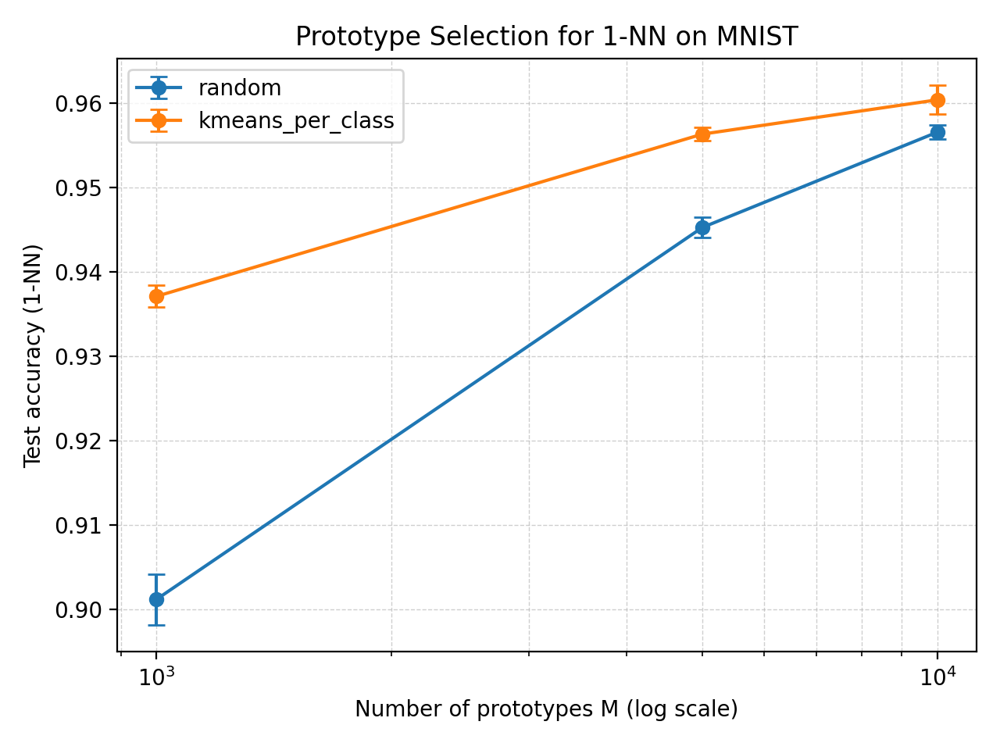
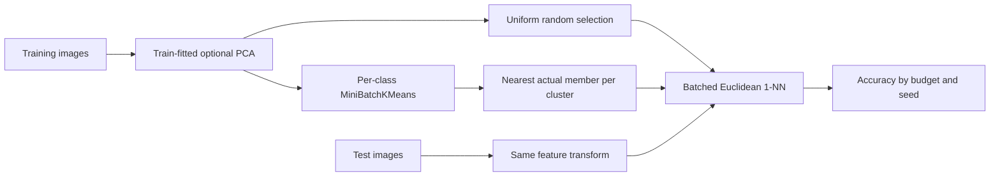
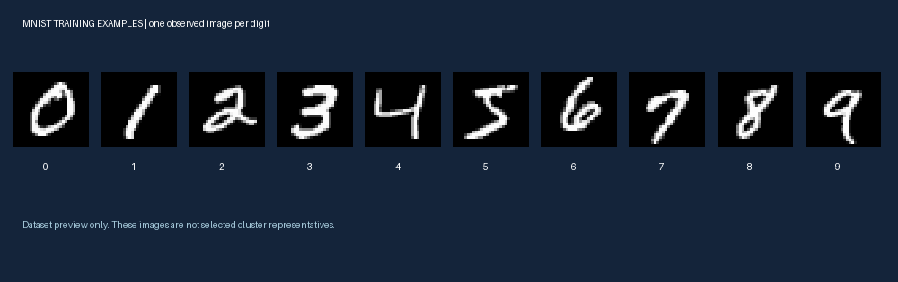

# MNIST Prototype Selection

**How much classification accuracy can 1-nearest-neighbor retain with a smaller reference set?**

An independently completed project by **Ashley Liu (Xinying Liu)** comparing uniform random selection with per-class clustering. The cluster method stores actual training examples nearest to fitted cluster centers, rather than synthetic centroids.



*Preserved experiment figure: means and approximate 95% t intervals across 10 prototype-selection trials. The shared test set is fixed; the intervals describe seed variation, not population-level accuracy uncertainty.*

## Results at a glance

| Prototype budget | Random accuracy | Per-class clustering accuracy | Gain |
|---|---:|---:|---:|
| 1,000 | 90.117% | **93.711%** | **+3.594 pp** |
| 5,000 | 94.528% | **95.635%** | +1.107 pp |
| 10,000 | 95.659% | **96.042%** | +0.383 pp |

Each row aggregates 10 runs per method. The advantage is largest at the smallest recorded budget and narrows as more examples are retained. These are **historical saved results**, audited from 60 CSV records; the full clustering sweep was not rerun during portfolio preparation.

For 1,000 prototypes, the paired mean gain is **3.594 percentage points**, with an approximate 95% t interval of **[3.318, 3.870] pp** across matched trial seeds. Pairing by seed does not make the samples identical; it aligns the recorded repetitions. [Paired analysis](results/historical/paired_analysis.json) · [Raw trials](results/historical/results.csv) · [Summary](results/historical/summary.csv).

## Method



1. Normalize pixel values and optionally fit PCA on training images only.
2. Allocate the clustering budget approximately equally across the observed classes.
3. Run MiniBatchKMeans independently within each class, selecting the nearest assigned member to each center.
4. Deduplicate selected indices; fill any shortfall from remaining training rows.
5. Classify using batched squared Euclidean distance: `||x-p||² = ||x||² + ||p||² − 2x·p`.



*Dataset preview: one observed training image per class. These are not the selected clustering representatives.*

## Experimental interpretation

The random baseline uses a global sample, while clustering also imposes class quotas. The historical comparison therefore combines **geometric coverage and class allocation**; it does not isolate clustering alone.

The selected runner defaults to PCA dimension 50 and budgets 1,000/5,000/10,000. Historical outputs do not include a complete run configuration or dependency lockfile, so those defaults are not proof of the exact settings used to produce the saved scores. The MNIST loader uses the standard train/test split when torchvision mode is selected; CSV mode has different split behavior.

At a fixed feature dimension, reference-feature storage scales with `M × d`, and brute-force prediction work with `N_test × M × d`. That is a complexity argument, not a measured speedup. PCA parameters and temporary working arrays also consume memory. No measured clustering-selection latency or full-reference 1-NN accuracy was recovered from the historical run.

## Newly executed class-balance diagnostic

An offline extension tests whether class quotas alone help in one small setting. It uses a seeded sample of **5,000 training / 1,000 test images**, **300 prototypes**, 784 normalized raw-pixel features and **no PCA**.

| Selection method | Accuracy | Stored feature bytes |
|---|---:|---:|
| Uniform random | **82.1%** | 940,800 |
| Class-balanced random | 81.4% | 940,800 |

This single-seed experiment found no improvement from equal class counts. It does not establish that balance is generally harmful or isolate the historical clustering effect. Different features, budgets and sample sizes prevent direct comparison with the main table.

Selection/prediction timings and class counts are recorded in [diagnostic metrics](results/offline-ablation/metrics.json). These one-shot timings are sanity checks, not stable latency benchmarks. Reported feature bytes describe array payload only, not process peak memory. The distance-matrix estimate excludes other simultaneous temporaries.

## Run locally

### Audit saved results without data or model downloads

Python 3.10+:

```bash
python scripts/audit_results.py
python -m pip install -r requirements-offline.txt
python -m unittest discover -s tests -v
```

The audit uses only the standard library. Five offline tests passed locally, covering batched 1-NN against a direct reference, deterministic unique class-balanced selection, short-class fallback, invalid budgets and IDX payload validation.

### Reproduce the offline diagnostic

Use a local `MNIST/raw` directory containing uncompressed training/test image and label IDX files:

```bash
python scripts/offline_ablation.py --raw /path/to/MNIST/raw --out runs/offline-check
```

The script writes aggregate results, dataset hashes and selected-index hashes. It requires a new empty output directory and does not download the dataset.

### Run the original clustering pipeline

```bash
python -m pip install -r requirements-torchvision.txt
python run_experiments.py --data torchvision --Ms 1000 5000 10000 --trials 10 --pca_dim 50 --outdir runs/full
```

Torchvision mode may download MNIST. For labelled CSV files, install `requirements.txt` and use `--data csv --csv_train train.csv --csv_test test.csv`. An unlabelled test CSV causes an internal stratified split of training data; it is not equivalent to the official test split.

Start with `--Ms 100 --trials 1 --limit_train 2000 --limit_test 500` to check the configured pipeline. Such a subset run must be labelled separately from full-dataset results. The original runner can overwrite its output files; use a different directory per experiment.

## Provenance and verification

Two local source copies were found. The outer `run_experiments.py` contains an `args.tri als` syntax error; this repository selects the valid nested source copy and preserves the outer saved CSVs and plot. No exact source-to-result reproduction is claimed. Source hashes and selection reasoning are in [the manifest](docs/source-manifest.json).

Original code remains distinct from the added IDX reader, class-balance diagnostic, tests, paired-result audit and portfolio documentation. The additions were prepared with AI assistance. See [technical report](docs/REPORT.md) and [validation record](docs/VALIDATION.md).

## Repository guide

| Path | Purpose |
|---|---|
| `select_prototypes.py` | Original random and per-class clustering selection |
| `features.py` / `knn_eval.py` | Original feature transform and batched 1-NN |
| `data.py` / `run_experiments.py` | Original loaders and experiment runner |
| `prototype_lab/` | Added offline IDX and selection diagnostic utilities |
| `results/historical/` | Preserved plot, raw trials and audited paired analysis |
| `results/offline-ablation/` | Newly executed subset diagnostic |
| `tests/` / `scripts/` | Checks, audit and demo utilities |

The next useful experiment is a matched three-way comparison of global random, class-balanced random and per-class clustering, using validation to choose settings before a final test evaluation. Multi-seed selection timing, peak memory and a full-reference baseline remain future work.

No blanket license has been assigned. MNIST data and third-party software retain their own terms; raw dataset files and local environments are not bundled.
